# Module 12.5: GitOps with ArgoCD

Jenkins builds and tests. Git decides what runs. ArgoCD makes the cluster match.

In this module I rebuilt my ClearOps app's delivery so that **the CI server has no access to the cluster at all**. Jenkins ends its pipeline by committing a new image tag to a config repo. ArgoCD, running inside the cluster, pulls that repo and deploys. Every deploy is a git commit, every rollback is a `git revert`, and manual changes to the cluster are undone in seconds.

Everything ran on a local Minikube cluster in WSL, so there was no cloud bill. It was torn down at the end; the repos below are the record.

| Repo | Role |
|---|---|
| [clearops-app](https://github.com/vivianokose/clearops-app) | **App repo.** Source code, Dockerfiles, Jenkinsfile. |
| [clearops-gitops](https://github.com/vivianokose/clearops-gitops) | **Config repo.** Kubernetes manifests per environment, ArgoCD Applications. Its `git log` is the deploy history. |
| This folder | Docs, the local Jenkins setup, the rollback runbook, screenshots. |

---

## Architecture

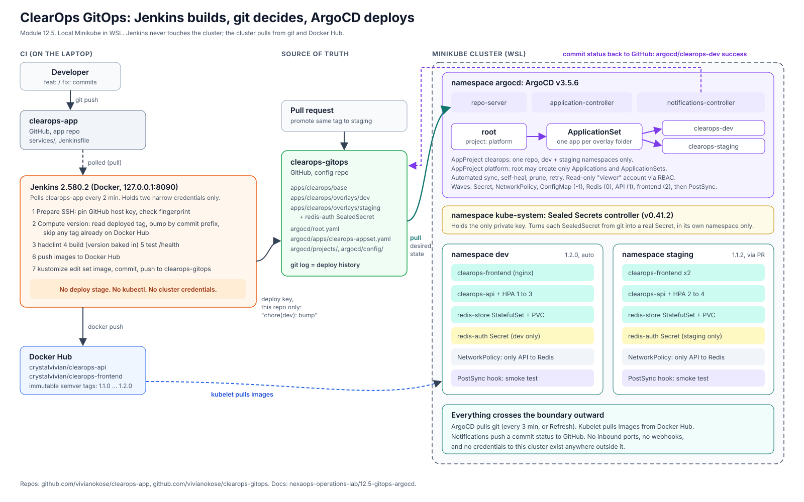

The key property is the direction of every arrow: **everything crosses the cluster boundary outward.** ArgoCD pulls git, the kubelet pulls images, and ArgoCD pushes a commit status to GitHub. No inbound ports, no webhooks into the cluster, and no credentials for the cluster exist anywhere outside it.

---

## Results at a glance

| What | Evidence |
|---|---|
| CI has no cluster access | Pipeline ends at a commit to clearops-gitops; Jenkins holds only a Docker Hub token and a deploy key for one repo |
| Drift is undone automatically | A manual ConfigMap edit was reverted in about **2 seconds** |
| Real rollback through git | Bad release 1.1.1 reverted with `git revert`, live again within a minute |
| A tag is never reused | After the rollback, the next fix became **1.1.2**, not 1.1.1 again |
| Management layer swapped with no downtime | App of Apps children replaced by an ApplicationSet; **0 pod restarts** |
| Secrets safe in a public repo | Redis password committed only as a SealedSecret; Redis refuses clients without it |
| Deploys reported back to git | Each deployed commit gets a GitHub status, `argocd/clearops-dev: success` |

---

## How it was built

### 1. Install and lock down ArgoCD

ArgoCD v3.5.6, with the server pinned to the same version as the CLI (the CLI download was checked against its published checksum). The auto-generated admin password was changed and its Secret deleted.

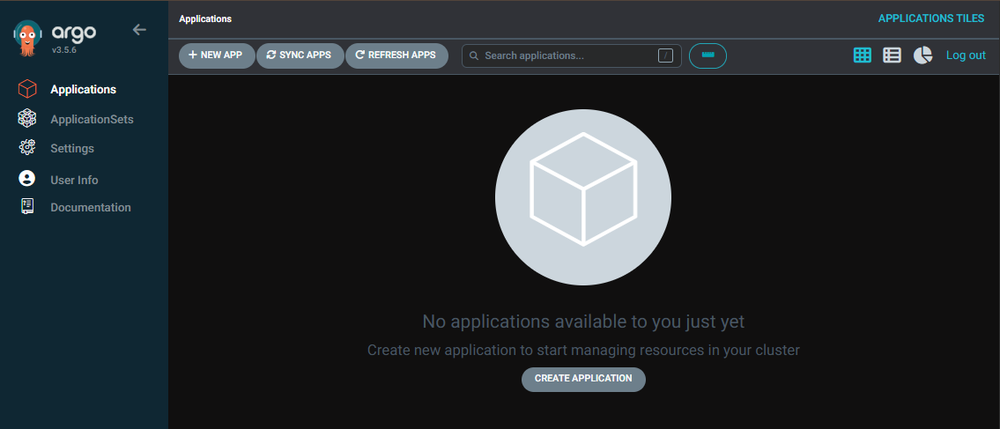

I added a local `viewer` account with ArgoCD's built-in read-only role, and anyone not listed gets nothing. Checked with a control test: viewer can `get` but not `create` or `sync`; admin can `create`.

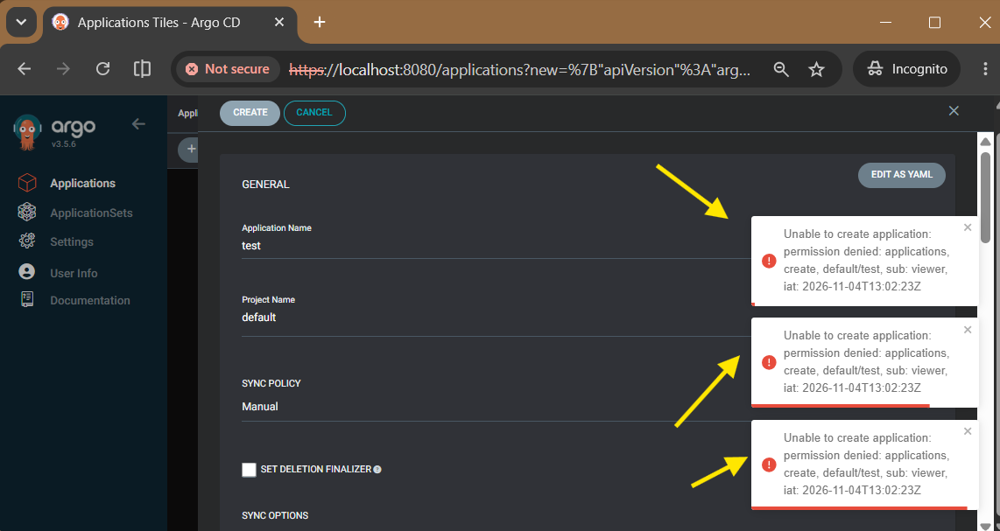

### 2. A config repo, with guardrails

The ClearOps manifests from Module 10 became a Kustomize **base** plus **dev** and **staging** overlays (namespace, image tags, HPA bounds and log level differ; nothing else does). Moving them also exposed a Module 10 bug: the NetworkPolicy and Redis host still pointed at an old Redis Deployment, so the policy protected nothing. Both now point at the `redis-store` StatefulSet.

An **AppProject** limits ClearOps to one repo, the `dev` and `staging` namespaces, and no cluster-wide objects except Namespaces.

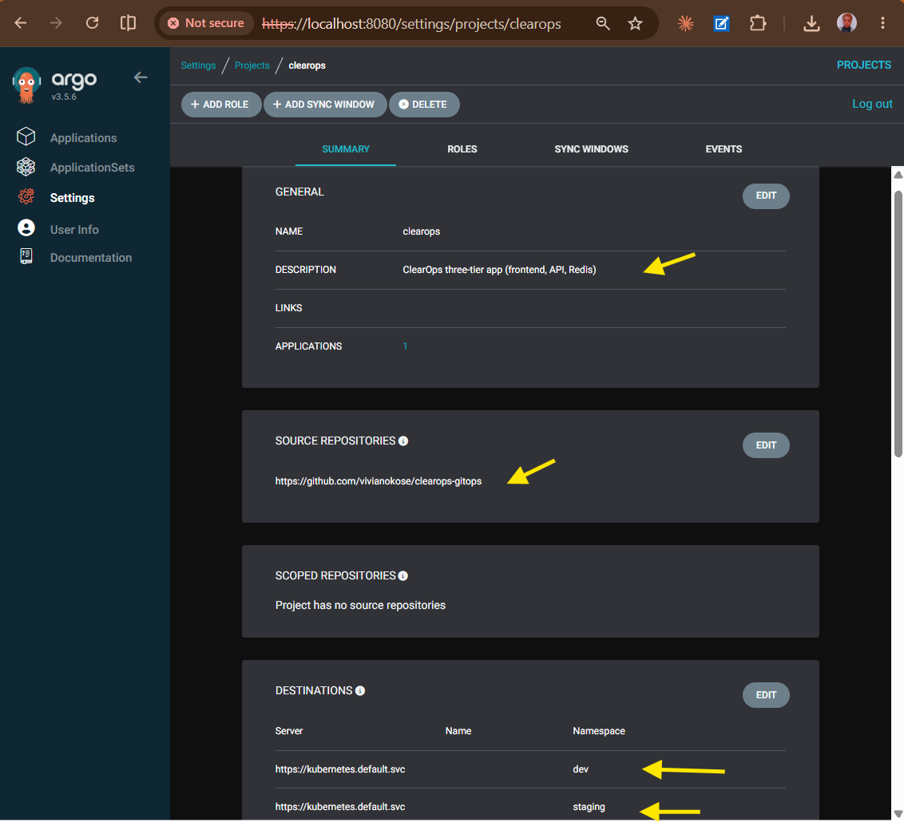
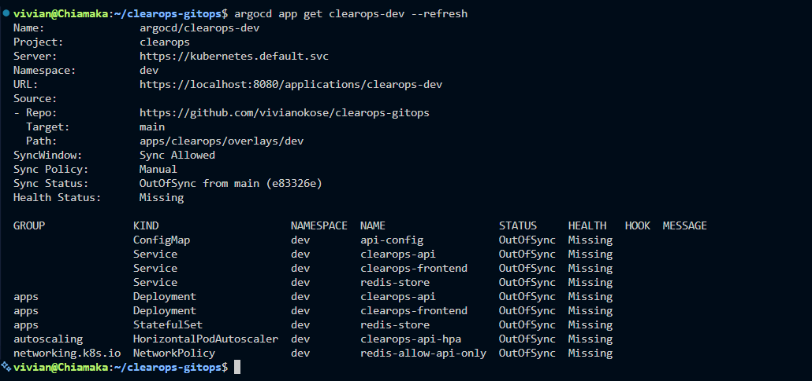

### 3. Ordered deploys and a smoke test

**Sync waves** deploy in a fixed order: config and the NetworkPolicy first, then Redis, then the API, then the frontend. A **PostSync hook** runs a smoke test against both services once everything is healthy. This is Module 8's verify stage, moved into the cluster.

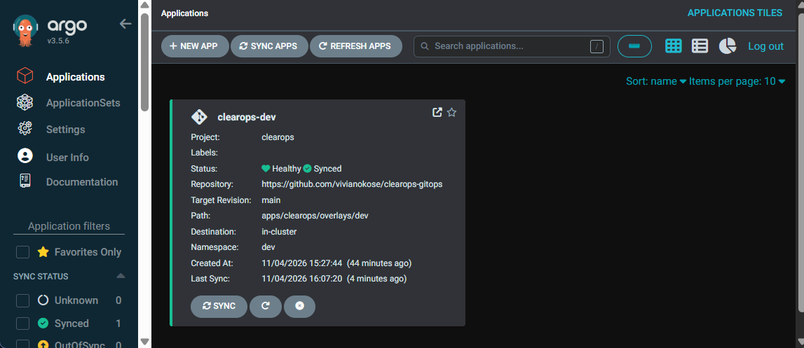
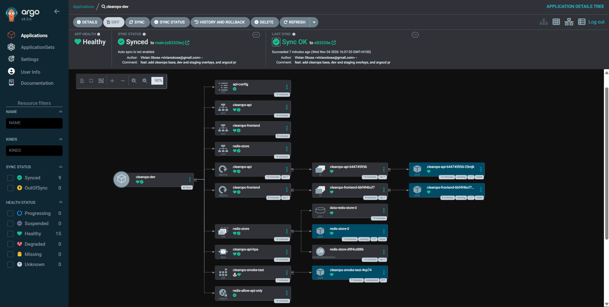
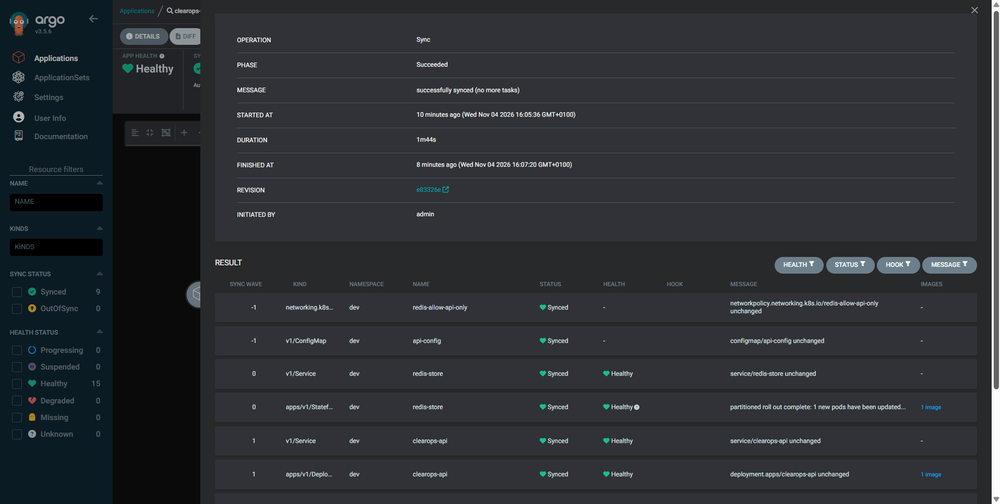
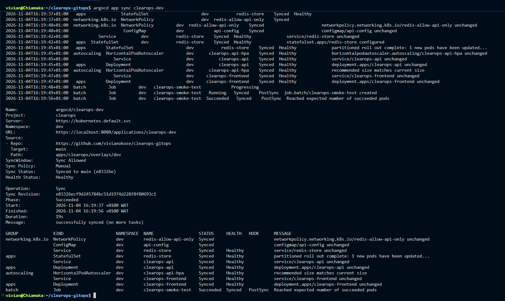

**The first sync failed.** The HPA was in wave 1, and a seconds-old pod has no CPU metrics yet, so the HPA reported Degraded. ArgoCD waits for each wave to be healthy, so the frontend and the smoke test never ran. The app was Healthy but OutOfSync. A re-sync a minute later worked, and the permanent fix was a `retry` policy on the Application.

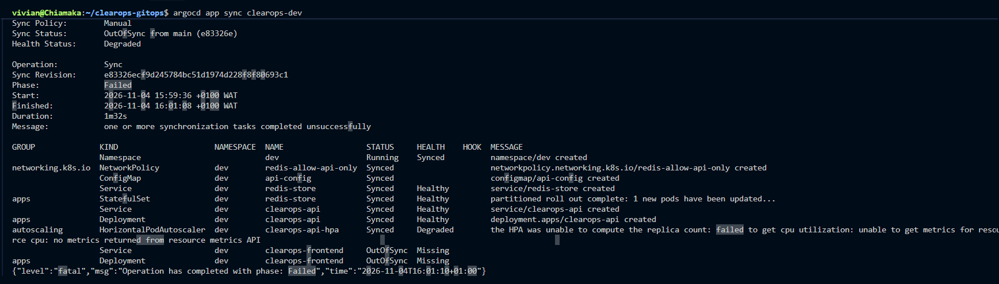

### 4. Drift and self-heal

I changed `LOG_LEVEL` in the ConfigMap by hand, the way an on-call engineer might at 2am, and turned on the three sync switches one at a time:

| Policy | What happened to the manual change |
|---|---|
| Manual | Detected and shown as a diff, left alone |
| Automated only | Left alone. Automated reacts to new **commits**, not to the cluster |
| Automated + selfHeal | Reverted in about 2 seconds |

A side lesson: the commit that switched automated on was itself a new commit, so it quietly overwrote the drift. Any commit to the watched branch makes ArgoCD re-apply everything, which is exactly how undocumented hotfixes disappear.

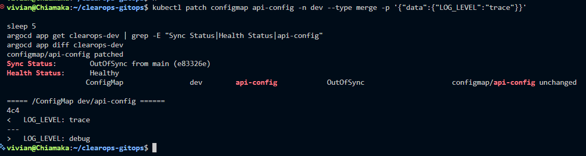
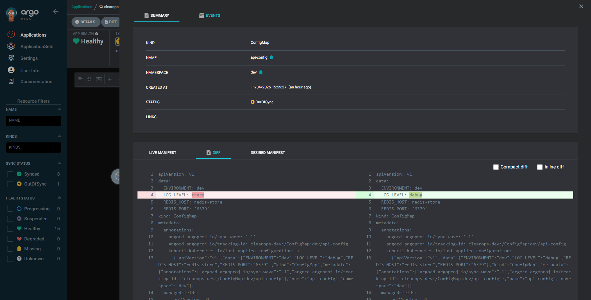
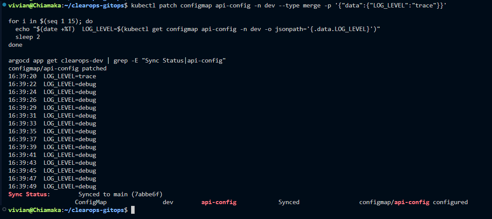

The API Deployment has **no `replicas` field** in git. The HPA owns that number; if git owned it too, self-heal and the HPA would fight forever.

### 5. Prune

A ConfigMap removed from git stayed in the cluster as an orphan until prune was switched on, then it was deleted. The Redis PVC is safe from prune by design: the StatefulSet creates it, not ArgoCD, so ArgoCD never owned it.

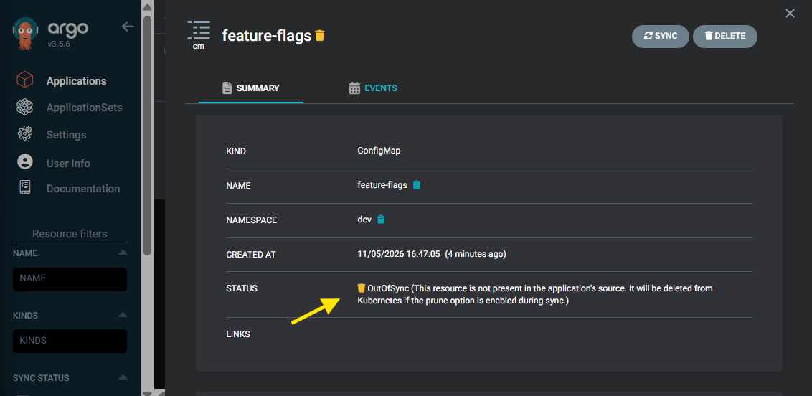
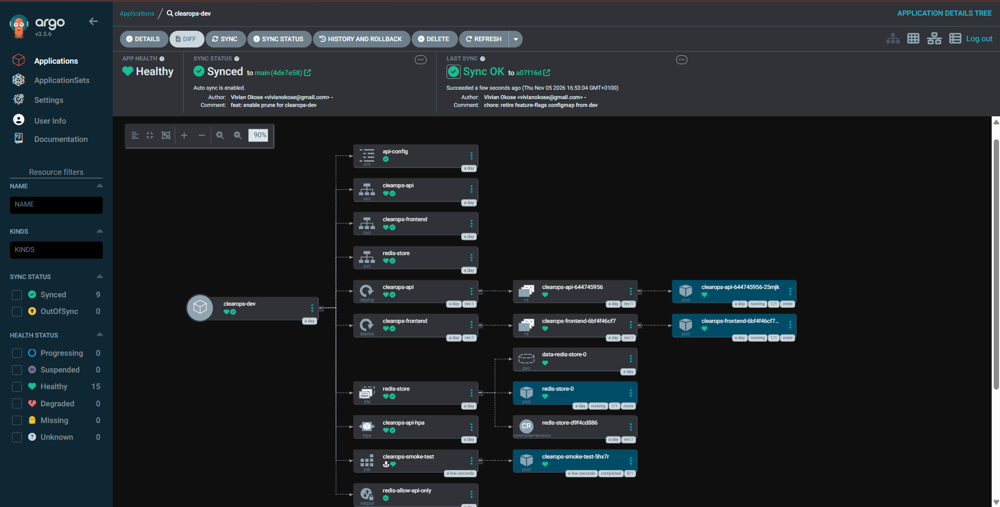

### 6. Jenkins builds, git deploys

Jenkins runs locally in Docker ([jenkins/](jenkins/)): pinned image, Docker CLI and kustomize baked in, bound to `127.0.0.1` only. It polls the app repo every 2 minutes, because a laptop has no public address for webhooks.

| Stage | Purpose |
|---|---|
| Prepare SSH | Pins GitHub's host key and checks its fingerprint (no `StrictHostKeyChecking=no`) |
| Compute version | Reads the **deployed** tag from the rendered dev overlay, bumps it by commit prefix (`feat` minor, `fix` patch), validates it, and skips any tag already on Docker Hub |
| Lint, build, test | hadolint; the version is baked into the image; the test checks `/health` reports that exact version |
| Push | Docker Hub token passed through stdin, inside single quotes |
| Update GitOps repo | `kustomize edit set image`, commit, push with a deploy key that works on one repo only |

There is **no deploy stage**.

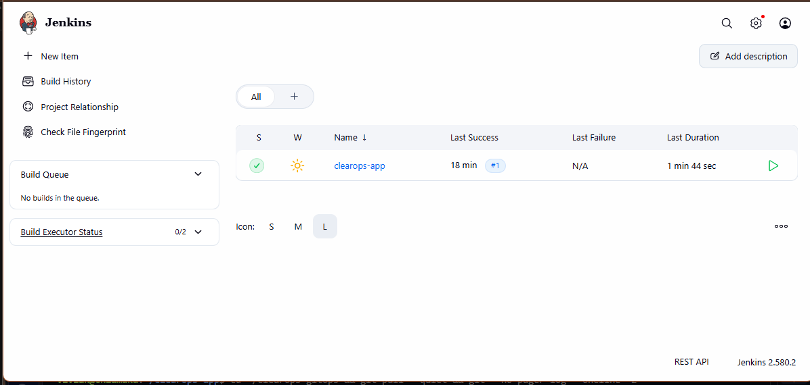
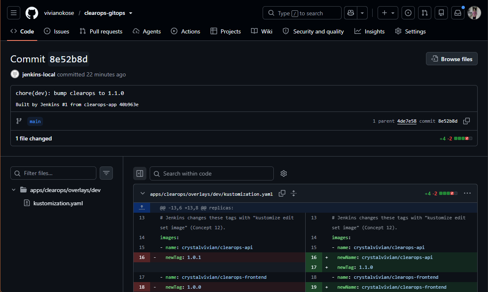
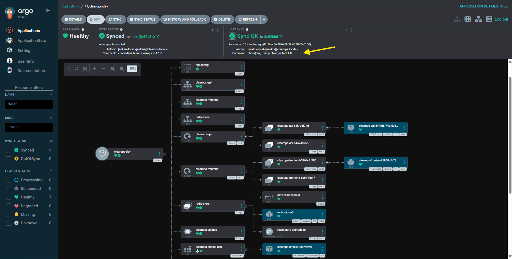
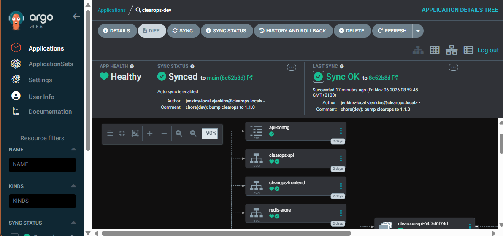

**Build #2 failed with the tag `..1`.** My version stage read the line after the image name in `kustomization.yaml`, but `kustomize edit` had inserted a `newName` line there, so the version came back empty. It now reads the version from the **rendered** overlay and stops loudly if the value isn't `x.y.z`. The bigger lesson: the empty value travelled two stages before anything complained.

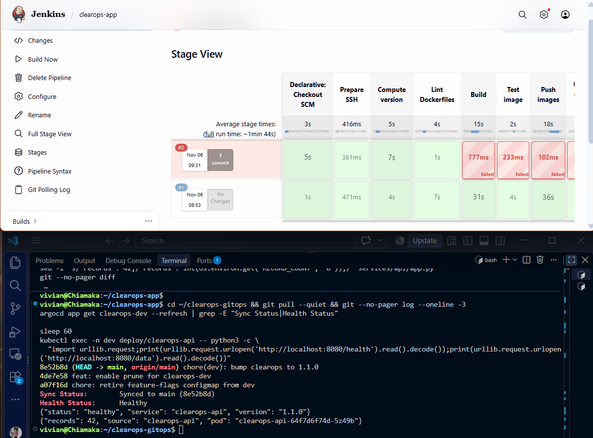

### 7. A real bad release, rolled back through git

Release **1.1.1** made a record count "configurable" but never set the config, so `/data` returned 0 records instead of 42. Health checks passed and everything showed green. I rolled it back with `git revert` on the config repo; ArgoCD redeployed 1.1.0 within a minute.

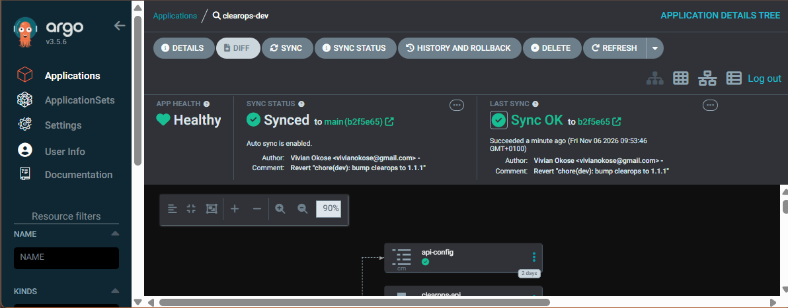

Then a trap: with 1.1.0 deployed again, the next fix would have been numbered **1.1.1**, overwriting the bad image on Docker Hub, while the cluster kept running its cached copy of the bug. The pipeline now asks Docker Hub whether a tag exists and skips it if so. The fix shipped as **1.1.2**.

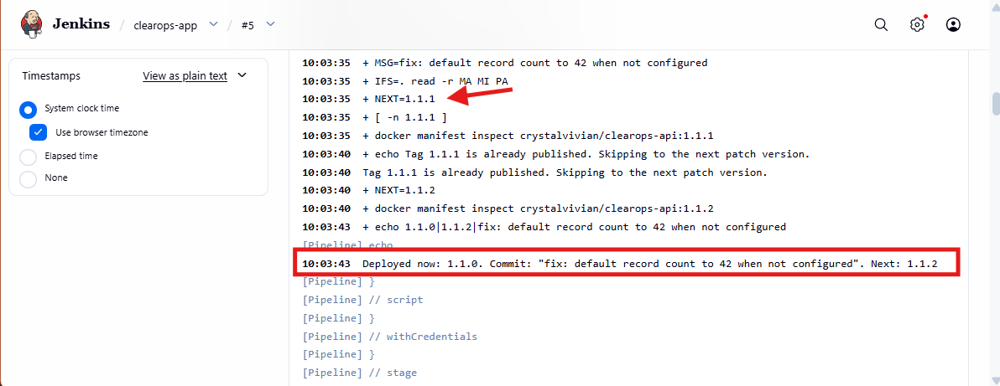

The full procedure, including a break-glass path and an incident record, is in **[runbooks/gitops-rollback.md](runbooks/gitops-rollback.md)**.

### 8. App of Apps, and promotion by pull request

A single **root** Application now owns every other Application. Rebuilding the whole setup means installing ArgoCD, applying two AppProjects and `root.yaml`; everything else comes from git. The root has its own `platform` project that may create only Applications and ApplicationSets, and its prune is **off**, so deleting one file can't delete an environment.

Staging only moves on purpose: release 1.1.2 was promoted from dev to staging through a reviewed pull request. Same image, not rebuilt.

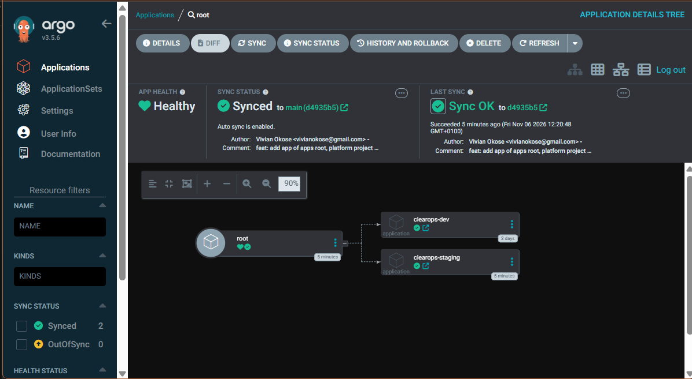

### 9. ApplicationSet, swapped in with zero restarts

The per-environment Application files were replaced by one **ApplicationSet** that creates an Application for every folder under `overlays/`. The handover released the old Applications without deleting their workloads (`--cascade=false`), then let the ApplicationSet adopt them. Every pod's start time was identical before and after.

One honest mistake: I removed the old files and added the new one in separate commits, so for one commit `argocd/apps/` was empty, and git doesn't keep empty folders. The root failed with "app path does not exist" and **refused to act** rather than pruning anything. Adding the new file and removing the old ones in one commit avoids that.

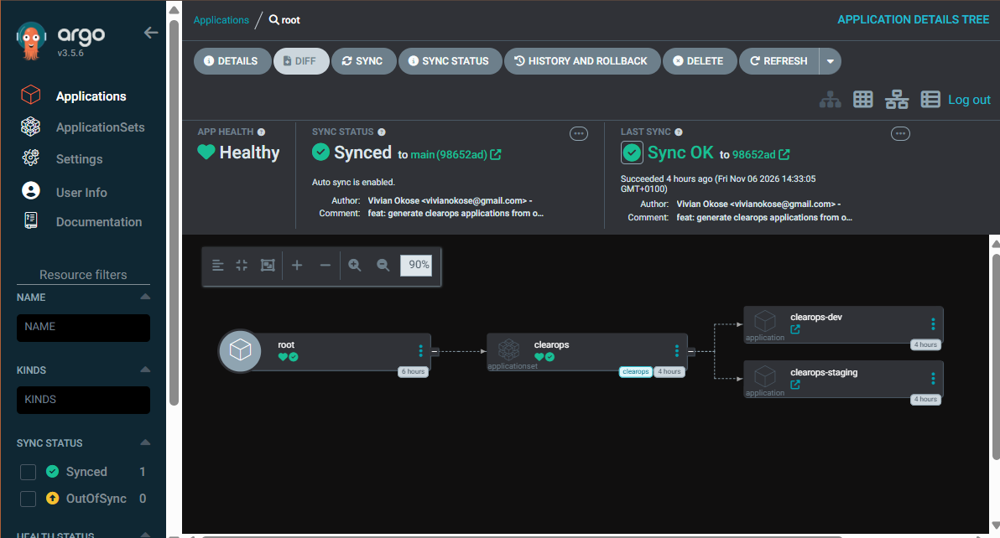

### 10. Sealed Secrets for Redis

Redis now requires a password. It's committed to the public config repo only as a **SealedSecret**, encrypted with a key that exists only inside the cluster. The plain password was generated, sealed and committed in one pipe, without ever being printed or written to disk. Each environment has its own; a dev secret copied into staging fails with "no key could decrypt secret".

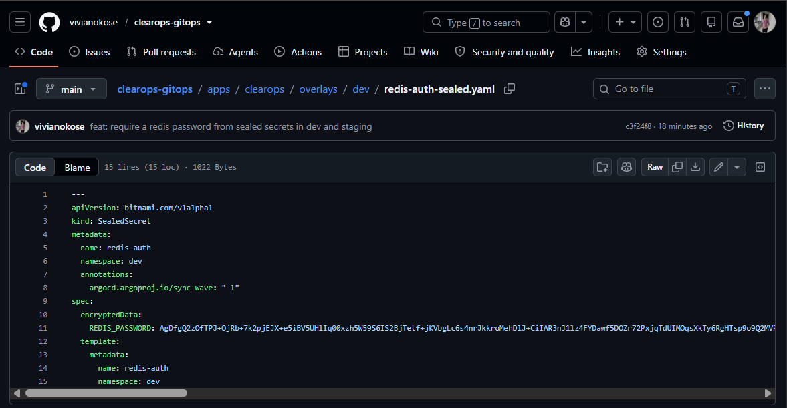

### 11. Deploy results written back to GitHub

ArgoCD's notifications controller posts a commit status for every successful or failed sync, using a fine-grained token that can only set statuses on the config repo. A green tick on a commit means it is actually running.

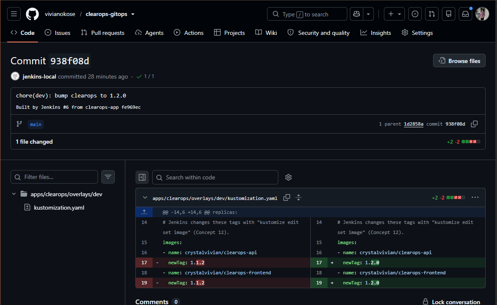
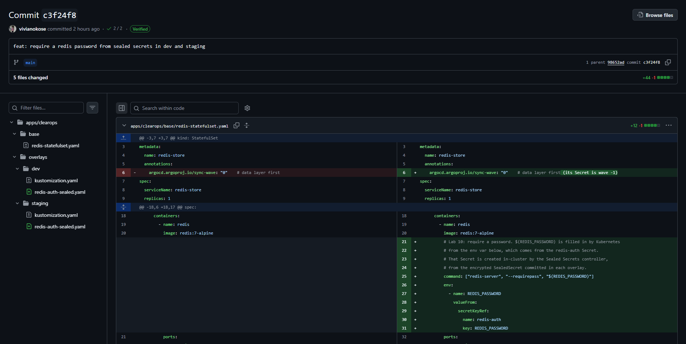

A config-only commit gets no tick when nothing in the cluster changes. ArgoCD compares on every commit but only runs a sync when something differs, and the status means "this commit changed what's running."

---

## Security decisions

- **No cluster credentials outside the cluster.** CI's job ends at git.
- **Least privilege everywhere:** a deploy key for one repo; a Docker Hub token; a GitHub token limited to commit statuses on one repo; AppProjects that limit what each Application may deploy, including the root.
- **Pinned and verified tools:** ArgoCD, kubeseal and kustomize versions pinned; downloads checked against published checksums; GitHub's SSH host key pinned and fingerprint-checked.
- **Immutable image tags**, enforced by the pipeline.
- **Known risk, accepted for a laptop:** Jenkins builds through the host's Docker socket, which is effectively root on that machine. Production would use separate build agents or a daemonless builder.
- **An honest slip:** during Lab 11 a GitHub token was pasted where the prompt text belonged, so it was printed on screen. It was revoked straight away, scrubbed from shell history, and replaced. Its narrow scope meant the exposure was limited to commit statuses on one repo.
- **Teardown revoked every credential**, and the Jenkins volume holding them was deleted.

## Versions

| Tool | Version |
|---|---|
| ArgoCD (server and CLI) | v3.5.6 |
| Sealed Secrets / kubeseal | v0.41.2 |
| Jenkins | 2.580.2 (lts-jdk21) |
| Kustomize | v5.3.0 laptop, v5.4.3 in Jenkins |
| Kubernetes (Minikube) | v1.37.0 |

Full captured state, including both repos' commit history, is in [final-state.txt](final-state.txt).

## Rebuilding from scratch

```bash
minikube start --driver=docker --memory=4096 --cpus=2 && minikube addons enable metrics-server
kubectl create namespace argocd
kubectl apply -n argocd --server-side --force-conflicts \
  -f https://raw.githubusercontent.com/argoproj/argo-cd/v3.5.6/manifests/install.yaml
# Sealed Secrets controller, then reseal the two redis-auth secrets (the old key died with the old cluster)

git clone https://github.com/vivianokose/clearops-gitops && cd clearops-gitops
kubectl apply -f argocd/projects/clearops.yaml -f argocd/projects/platform.yaml
kubectl patch configmap argocd-notifications-cm -n argocd --patch-file argocd/config/argocd-notifications-cm-patch.yaml
kubectl apply -f argocd/root.yaml      # everything else comes from git
```

## Scope decisions

- **Sealed Secrets controller installed with kubectl, not by ArgoCD.** Managing it from ArgoCD needs cluster-wide permissions (CRDs) that no project here was given. In production it would be its own Application under a tightly scoped platform project.
- **Environments are namespaces on one cluster.** Fine for a demo; production would give prod its own cluster.
- **Polling instead of webhooks** for both Jenkins and ArgoCD, because a laptop has no public address.

## Glossary

| Term | Meaning |
|---|---|
| GitOps | Git is the only source of truth; an agent in the cluster pulls it and keeps the cluster matching |
| Application | ArgoCD object: which repo and folder to deploy, to which cluster and namespace |
| AppProject | Guardrails for a group of Applications |
| Synced / Healthy | Two separate questions: does the cluster match git, and does it work |
| Self-heal | ArgoCD undoing manual changes in the cluster |
| Prune | Deleting from the cluster what was removed from git |
| Sync wave / hook | Deploy ordering, and one-off jobs before or after a sync |
| App of Apps | One root Application that creates the others from git |
| ApplicationSet | A template that generates Applications, here one per environment folder |
| SealedSecret | An encrypted Secret that only the in-cluster controller can unlock |

## Files in this folder

```
12.5-gitops-argocd/
├── README.md
├── architecture.png / architecture.svg
├── final-state.txt               versions, apps and commit history at teardown
├── jenkins/                      local Jenkins: Dockerfile, plugins.txt, docker-compose.yml
├── runbooks/gitops-rollback.md   rollback procedure and the 6 November incident record
└── screenshots/
```
